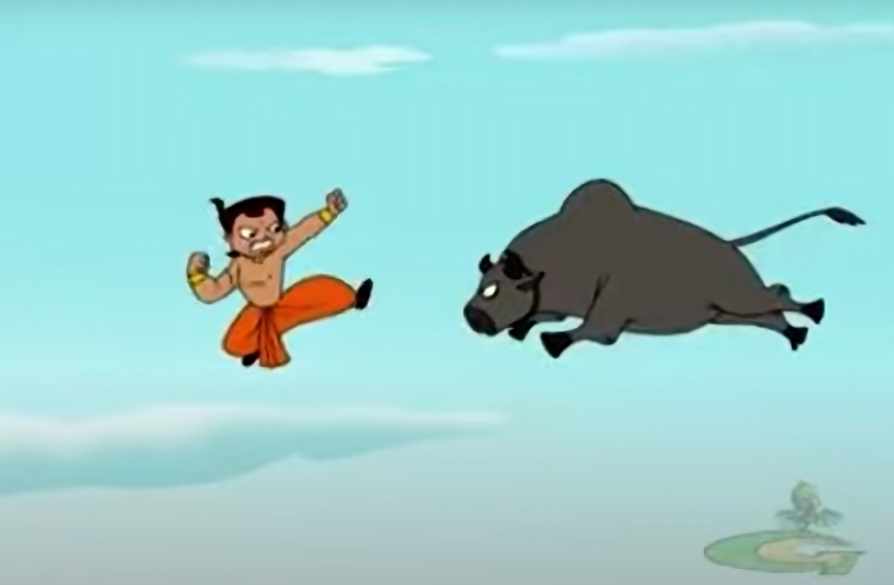
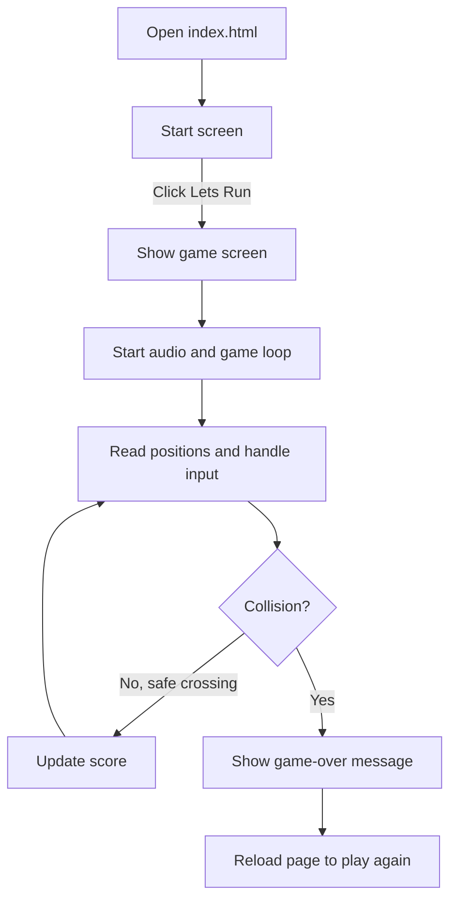

# 🎮 Chota Bheem Adventures

A lightweight browser-based obstacle game built with **HTML, CSS, and vanilla JavaScript**. Start the game, guide the character with the arrow keys, jump over the moving bull, and try to increase your score.

<p align="center">
  
</p>

<p align="center">
  <a href="https://github.com/Brajesh31/Chota-Bheem-Adventure-game/actions/workflows/quality-checks.yml"></a>
  
  
  
  
  
</p>

<p align="center">
  <b>Simple setup · Browser-based · Keyboard controls · No dependencies</b>
</p>

> **Project status:** A small playable prototype. The repository currently has a static game page, keyboard movement, CSS animations, collision/score polling, and local audio. It does not currently provide touch controls, saved scores, pause/resume, or an in-page restart.

## 📑 Contents

- [✨ Overview](#-overview)
- [🕹️ How to play](#️-how-to-play)
- [🧰 Requirements and setup](#-requirements-and-setup)
- [🧠 How it works](#-how-it-works)
- [🗂️ Repository structure](#️-repository-structure)
- [🧪 Testing](#-testing)
- [⚠️ Known limitations](#️-known-limitations)
- [🛡️ Security and privacy](#️-security-and-privacy)
- [🎨 Assets and licensing](#-assets-and-licensing)
- [🤝 Contributing](#-contributing)
- [🧭 Roadmap](#-roadmap)
- [📚 Documentation](#-documentation)

## ✨ Overview

The game uses three primary source files:

| File | Responsibility |
|---|---|
| `index.html` | Start screen, game screen, score element, and script/style links |
| `style.css` | Page layout, visual assets, character jump, and obstacle animation |
| `script.js` | Start action, keyboard input, collision polling, score, and audio |

The game runs entirely in the browser. There is no server, REST API, database, account system, package manager, or build pipeline.

## 🕹️ How to play

1. Open the game in a modern desktop browser.
2. Select **Lets Run** on the start screen.
3. Use the keyboard to avoid the bull.
4. Let the obstacle pass safely to increase your score.
5. After a collision, reload the page to start another session.

| Key | Action |
|---|---|
| ⬆️ Arrow Up | Jump |
| ⬅️ Arrow Left | Move left |
| ➡️ Arrow Right | Move right |

**Audio:** Background music begins after the start-button interaction. Browser mute settings and autoplay policies may affect playback.

## 🧰 Requirements and setup

- Modern desktop browser
- JavaScript enabled
- A local clone or downloaded copy of the repository

No npm install or environment secrets are needed.

```bash
git clone https://github.com/Brajesh31/Chota-Bheem-Adventure-game.git
cd Chota-Bheem-Adventure-game
```

Open `index.html` directly, or serve the directory locally:

```bash
python -m http.server 8000
```

Visit `http://localhost:8000`.

See [Installation](docs/installation.md) for details.

## 🧠 How it works

### Application flow



### Current runtime model

- CSS keyframes animate the jump and moving obstacle.
- JavaScript listens for arrow-key events.
- A 10 ms interval reads computed element positions.
- The score is held in a local variable and displayed in the page.
- Media is loaded from local relative paths.
- The only currently documented external request is the Google Fonts stylesheet.

This diagram describes the current code, not an idealized future architecture.

## 🗂️ Repository structure

```text
.
├── .github/
│   ├── ISSUE_TEMPLATE/
│   ├── DISCUSSION_TEMPLATE/
│   ├── workflows/
│   └── PULL_REQUEST_TEMPLATE.md
├── docs/
│   ├── diagrams/
│   ├── runbooks/
│   ├── templates/
│   └── project guides
├── index.html
├── style.css
├── script.js
├── frontPage.png
├── jungle.gif
├── bheem.gif
├── bull.gif
├── *.mp3
├── README.md
├── LICENSE
├── SECURITY.md
├── CONTRIBUTING.md
└── CHANGELOG.md
```

The repository also contains PNG and GIF variants that are not currently referenced by the running page. The [asset inventory](docs/assets.md) distinguishes used and unused media.

## 🧪 Testing

There is no automated browser test suite in the application at this time. Use the [manual test checklist](docs/testing.md) to check the start flow, keyboard controls, score, collision, assets, and viewport behavior.

The GitHub Actions workflow checks required files, local references, JavaScript syntax, YAML parsing, and non-empty Mermaid sources. It does **not** run interactive browser tests or prove gameplay correctness.

## ⚠️ Known limitations

- No mobile/touch controls.
- No pause, resume, settings, or in-page restart.
- Score is not persisted.
- Player movement is not clamped to the viewport.
- The collision interval is not explicitly cleared after game over.
- Several variables in the current script are assigned without declarations.
- Audio playback promise failures are not handled.
- Reduced-motion and screen-reader status support are incomplete.

See [Known issues](docs/known-issues.md) and [Roadmap](ROADMAP.md). These are documented limitations, not fixes delivered by this repository enhancement.

## 🛡️ Security and privacy

This static game has no user account system, backend, database, or application-managed persistence. Do not add private credentials to frontend files. The Google Fonts stylesheet causes a request to an external provider. Read [SECURITY.md](SECURITY.md) and the [security notes](docs/security.md).

## 🎨 Assets and licensing

The repository includes character images, animations, and audio. Their redistribution rights are not established by this repository metadata.

The root [MIT LICENSE](LICENSE) is intentionally scoped to original code and documentation authored by **Brajesh Kumar (@brajesh31)**. It does **not** grant rights to the Chota Bheem character, associated trademarks, third-party images/GIFs, or audio. Verify permissions independently before copying or redistributing those assets.

## 🤝 Contributing

Read [CONTRIBUTING.md](CONTRIBUTING.md), follow the [Code of Conduct](CODE_OF_CONDUCT.md), and use the issue/PR templates. Contributions that add media must include rights and attribution details.

## 🧭 Roadmap

Potential work includes a proper game-session lifecycle, bounded player movement, restart/pause, touch controls, better accessibility, and rights-cleared media. See [ROADMAP.md](ROADMAP.md).

## 📚 Documentation

Start at the [documentation hub](docs/README.md). It includes gameplay, architecture, configuration, data model, accessibility, testing, performance, troubleshooting, release guidance, diagrams, runbooks, and reusable templates.

---

<p align="center">
  Made with ❤️ using HTML, CSS, and JavaScript.
</p>

Last updated: 2026-11-17 11:48 UTC
