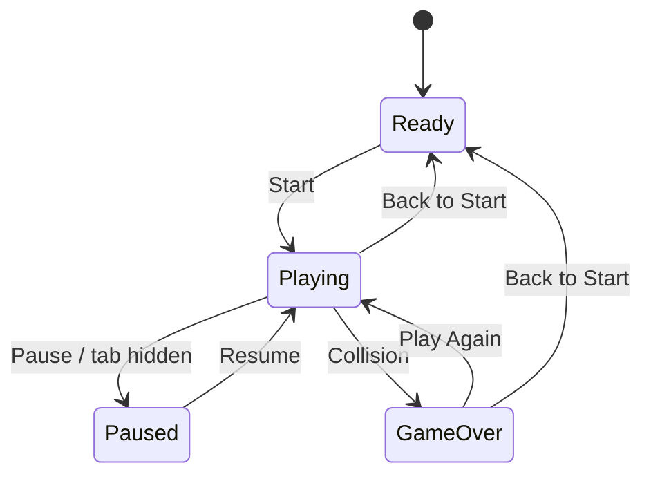

# 🧩 Data and State Model

## No persistent data store

The game has no database, local-storage persistence, application-managed cookies, user account, or server session. All gameplay state exists in memory for the current page session.

## Current session state

| State | Representation | Lifecycle |
|---|---|---|
| Score | `state.score`, reflected in `#scoreCount` | Reset on each start |
| Session active | `state.running` | True during active play |
| Pause status | `state.paused` | Set by Pause/Resume and page visibility |
| Score guard | `state.scoredThisPass` | Prevents duplicate score for one obstacle pass |
| Animation handle | `state.animationFrame` | Cancelled on pause/end/return |
| Jump timer | `state.jumpTimeout` | Cleared when jump or session resets |
| Player position | Inline CSS `left` value | Clamped to the game container |
| Obstacle position | CSS keyframe animation | Paused/resumed with session |

## Session state flow

## Persistence boundary

Closing or reloading the page resets the score and game state. There is no high-score storage, analytics, or server synchronization. Adding persistence would require a separately documented data lifecycle, reset control, and privacy review.
