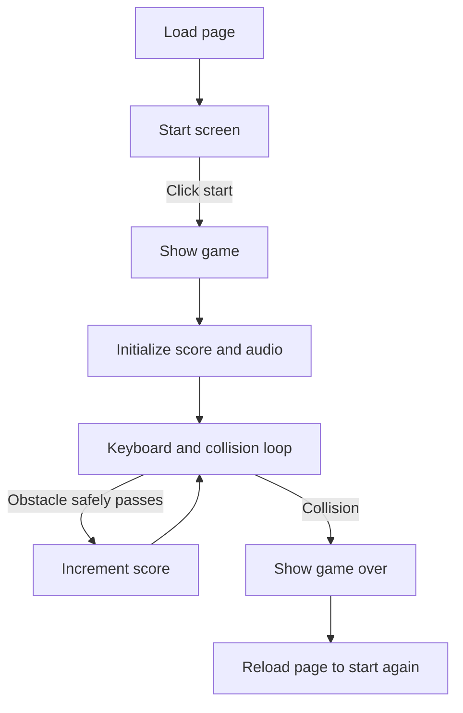

# 🧩 Data and State Model

## No persistent data store

The game has no database, local-storage persistence, cookies managed by the application, user account, or server session. State is held in JavaScript variables and DOM/CSS state for the current page lifetime.

## Current session state

| State | Current representation | Lifetime |
|---|---|---|
| Score | Local variable inside `startGame`, reflected in `#scoreCount` | Current page session |
| Crossing guard | Local boolean `cross` | Current game function scope |
| Player horizontal position | Inline CSS `left` value | Current page session |
| Jump state | CSS class `animateBheem` | Animation timeout |
| Obstacle state | CSS class and computed animation position | Current page session |
| Audio playback | Browser `Audio` objects | Current game session, without explicit teardown |

## State flow

## Future persistence

A high-score feature could use browser storage, but this would introduce stored data and should be documented with clear user expectations and a reset path. Cloud leaderboard functionality would require a backend and a separate security/privacy design.
