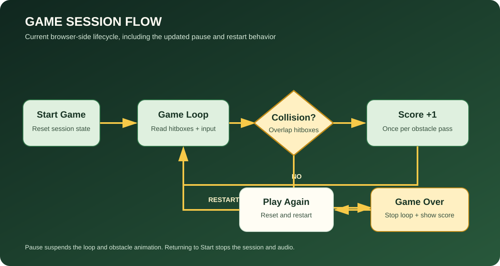

# 🗺️ Architecture and Workflow Diagrams

The Mermaid diagrams describe current implementation behavior. The session flow is also available as a standalone SVG image.

  

| Diagram | Purpose |
|---|---|
| [Application overview](application-overview.mmd) | Browser files and runtime modules |
| [Game state](game-state.mmd) | Start, play, pause, game-over, and restart |
| [Collision and score](collision-score.mmd) | Current collision and scoring decisions |
| [Input flow](input-flow.mmd) | Keyboard and on-screen controls |
| [Asset loading](asset-loading.mmd) | Local asset references |
| [Release flow](release-flow.mmd) | Manual verification and static publishing |
| [Security boundaries](security-boundaries.mmd) | Browser trust and media rights boundaries |
